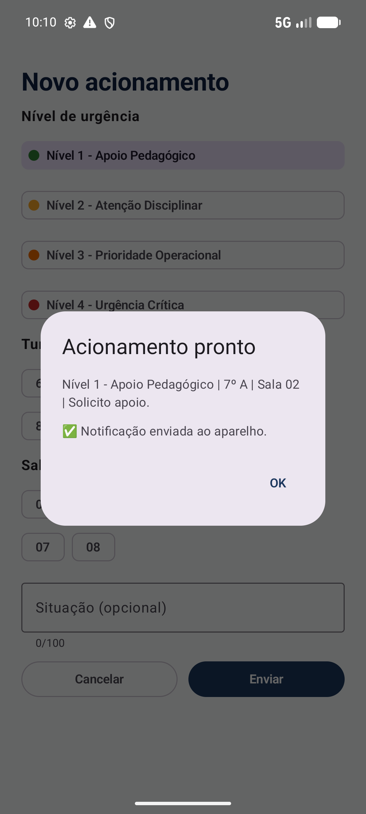
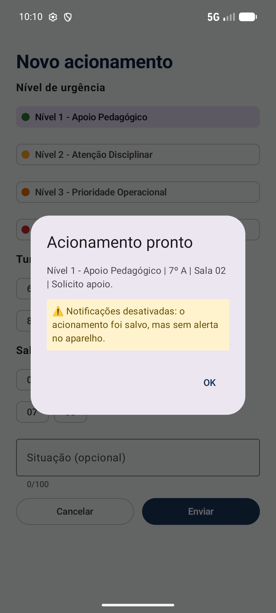
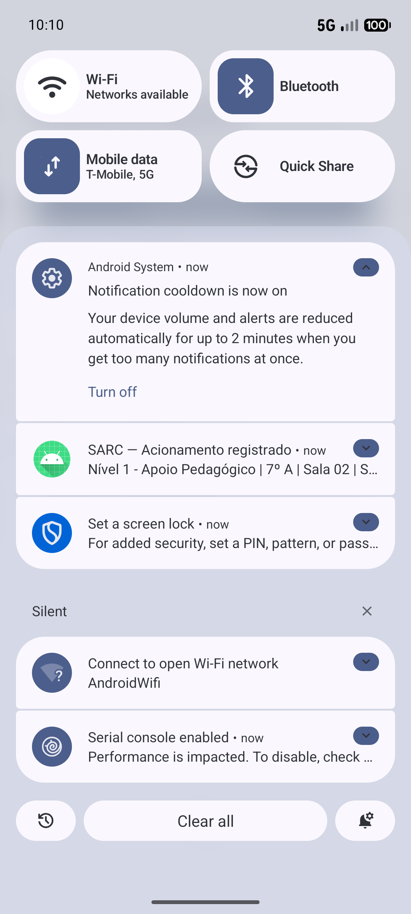

# SPRINT 06: External or Device Integration

## Team Identification

- **Team:** Team 05
- **Project:** SARC (Sistema de Acionamento e Resposta Cívico-Militar)
- **Institution:** Escola Estadual Cívico-Militar Maria de Lima Cadidé
- **Members:**
  - Matheus Gabriel de Morais Barros ([@MatheusGabriel-25](https://github.com/MatheusGabriel-25))
  - Paulo Vitor ([@PAULOSANTOS1309](https://github.com/PAULOSANTOS1309))

---

## 1. Chosen Integration

### Capability

**Notificações locais do Android** (`NotificationManagerCompat` e `NotificationCompat`, da biblioteca AndroidX Core que o projeto já usava). É uma capacidade do aparelho: não usa internet, servidor nem conta de terceiros.

### Product Relevance

Quando o professor envia um acionamento, o aparelho mostra na barra de notificações "SARC — Acionamento registrado" com a mensagem do protocolo. Assim ele tem um comprovante visível mesmo se sair do app ou bloquear a tela, que é o que acontece em sala de aula, quando ele envia e volta a atenção para a turma. É também o mesmo canal que, numa versão futura, vai avisar o Monitor Militar.

### Why this one

Era a opção de menor risco: sem internet, sem chave de API e sem biblioteca nova, então o critério de segredos (AC-06 do edital) não tem como falhar, e o código novo é pequeno o bastante para a equipe explicar linha por linha.

Detalhes completos e rastreabilidade em [`docs/specs/SPEC-006.md`](docs/specs/SPEC-006.md).

---

## 2. Data & Capability Flow

| Etapa | O que acontece | Onde está |
| --- | --- | --- |
| 1. Preparar | Ao abrir o app, o `MainActivity` cria o canal "Acionamentos SARC" (importância alta) | `MainActivity.kt` L54; `NotificacaoSarc.kt` L15-21 |
| 2. Pedir permissão | No Android 13 ou mais novo, ao entrar no Painel o app pede `POST_NOTIFICATIONS`, uma única vez por abertura | `MainActivity.kt` L73 e L90-99; `AndroidManifest.xml` L7 |
| 3. Acionar | O "Enviar" válido salva o acionamento (Sprint 05) e chama `NotificacaoSarc.enviar(...)` | `MainActivity.kt` L116-122 |
| 4. Verificar | `enviar` pergunta ao Android se as notificações estão ligadas (`areNotificationsEnabled()`) | `NotificacaoSarc.kt` L26 |
| 5a. Sucesso | Monta e dispara a notificação (título, mensagem, toque abre o app) e devolve `true` | `NotificacaoSarc.kt` L29-45 |
| 5b. Bloqueada | Não dispara nada e devolve `false` | `NotificacaoSarc.kt` L26 e L46-48 |
| 6. Mostrar | O formulário guarda o `true`/`false` em `notificou` e o diálogo "Acionamento pronto" mostra "✅" ou o aviso amarelo | `NovoAcionamentoScreen.kt` L149 e L162-170 |

### Explicação em uma frase (fluxo)

Formulário válido → o acionamento é salvo no Room → `enviar` pergunta ao Android se pode notificar → se pode, a notificação aparece na barra e o diálogo mostra "✅"; se não pode, nada aparece na barra e o diálogo mostra o aviso amarelo, e o acionamento fica salvo do mesmo jeito.

---

## 3. Asynchronous Behavior

- **Pedido de permissão:** a resposta do usuário não chega na hora. O `rememberLauncherForActivityResult` abre a pergunta do Android e devolve o resultado depois, por um callback, sem travar a tela. Por isso o pedido fica no Painel e não no "Enviar": o envio nunca fica esperando uma resposta.
- **Gravação no banco:** continua em coroutine (`scope.launch`, como na Sprint 05), sem `allowMainThreadQueries`.
- **A notificação em si** é gerada no próprio aparelho e sai na hora, por isso não existe estado de "carregando" (a SPEC-006 registra isso em Constraints).

---

## 4. Failure Handling

| O que pode falhar | Como o app reage |
| --- | --- |
| O professor nega a permissão | O acionamento é salvo normalmente; o diálogo mostra o aviso amarelo "⚠️ Notificações desativadas..."; o pedido não se repete a cada volta ao Painel |
| As notificações do SARC são desligadas nas Configurações | Mesmo resultado: `areNotificationsEnabled()` devolve `false` e o app não tenta notificar |
| O Android recusa a notificação mesmo assim | O `try/catch` de `SecurityException` em `enviar` devolve `false`; o app não trava |
| Android 12 ou mais antigo (sem pedido de permissão) | O app só confere `areNotificationsEnabled()`; nas versões 7 a 12 a permissão já vem concedida |

---

## 5. Privacy & Security Considerations

- **Nenhum dado sai do aparelho.** A notificação é local; o app não declara a permissão `INTERNET`.
- **Nenhum segredo no repositório:** sem chave de API, senha ou token (busca feita em `app/src`; nenhum `build/`, `.gradle/`, `.idea/` ou `local.properties` no Git).
- **Conteúdo da notificação:** mostra a mensagem do protocolo (nível, turma, sala e situação), sem nome de aluno nem dado pessoal. Em tela bloqueada, o Android controla o que aparece conforme a configuração do aparelho.
- **Permissão mínima:** só `POST_NOTIFICATIONS`.

---

## 6. Validation Scenarios

Todos os testes foram feitos no emulador `Pixel_8_API_37` (Android API 37).

### Cenário de sucesso (`integration-success.png`)

1. App reinstalado (dados limpos), "Entrar": o Android pergunta a permissão e tocamos em "Allow".
2. Enviamos `Nível 1 - Apoio Pedagógico | 7º A | Sala 02 | Solicito apoio.`
3. **Resultado:** a notificação "SARC — Acionamento registrado" aparece na barra (`integration-success-notification.png`), o diálogo mostra "✅ Notificação enviada ao aparelho." e tocar na notificação abre o SARC.

### Cenário alternativo: permissão negada (`integration-alternative-state.png`)

1. App reinstalado, "Entrar": tocamos em "Don't allow".
2. Enviamos o mesmo acionamento.
3. **Resultado:** nenhuma notificação aparece, o diálogo mostra o aviso amarelo, e o acionamento aparece em "Meus acionamentos". Depois do "OK", o Painel não pergunta a permissão de novo.

### Notificações desligadas depois de concedidas

Com a permissão concedida e depois retirada (`adb shell pm revoke ... POST_NOTIFICATIONS`), o envio mostrou o aviso amarelo, sem crash. (O interruptor da tela de Configurações não foi tocado à mão; o comando leva o Android ao mesmo estado.)

### Regressão das Sprints anteriores

| Item testado | Resultado |
| --- | --- |
| Modais "Sobre o SARC" e "Solicitação de Cadastro" (Sprint 02) | PASS |
| Fluxo `Login → Entrar → Painel → Sair → Login` e voltar do Android (Sprint 03) | PASS |
| Validação do formulário vazio: "Escolha o nível", "Escolha a turma", "Escolha a sala" (Sprint 04) | PASS |
| Histórico salvo e botão "Resolvido" → "✓ Resolvido" (Sprint 05) | PASS |
| Estabilidade (10 envios seguidos + logcat) | PASS: `./gradlew assembleDebug` com `BUILD SUCCESSFUL` e 0 `FATAL EXCEPTION` |

---

## 7. Acceptance Criteria (Curso)

- [x] AC-01: SPEC-006 exists (`docs/specs/SPEC-006.md`).
- [x] AC-02: Integration is relevant to the product goal (seção 1).
- [x] AC-03: App can trigger the integration (envio do formulário, seção 2).
- [x] AC-04: Successful result is observable (notificação na barra e "✅" no diálogo).
- [x] AC-05: At least one alternative/denied/unavailable state is handled (aviso amarelo, seções 4 e 6).
- [x] AC-06: No private secrets are committed (seção 5).
- [x] AC-07: Previous functionality remains operational (tabela de regressão da seção 6).
- [x] AC-08: App builds/runs successfully (`./gradlew assembleDebug`: `BUILD SUCCESSFUL`).
- [x] AC-09: Success and alternative-state evidence exists (seção 8).
- [ ] AC-10: Team can explain the integration flow (fluxo na seção 2; o Matheus e o Paulo marcam depois de estudar).

---

## 8. Evidence

### Success (`integration-success.png`)

### Alternative state: permission denied (`integration-alternative-state.png`)

### Notification in the status bar (extra)

---

## 9. AI Usage

| Item | Team response |
| --- | --- |
| LLM/tool used | Claude Code (Anthropic) |
| Task supported by the LLM | Escolher a integração, rascunhar a `SPEC-006.md`, escrever o código da notificação (`NotificacaoSarc.kt` e as mudanças em `MainActivity.kt`, `NovoAcionamentoScreen.kt` e no manifesto), compilar, executar os testes no emulador pelo `adb` e capturar as evidências |
| Main suggestion received | Notificação local em vez de uma API externa (sem internet nem segredo); todo o código da notificação em um arquivo só; pedir a permissão ao entrar no Painel e não no "Enviar"; mostrar o resultado no diálogo que já existia, sem tela nova; `areNotificationsEnabled()` para cobrir permissão negada e notificações desligadas |
| What the team changed manually | O Matheus planejou a Sprint junto com a IA, passo a passo, e verificou cada etapa: aprovou o plano em módulos, leu o rascunho completo da SPEC e o rascunho do código antes de qualquer arquivo ser escrito, e decidiu as 3 escolhas de comportamento (permissão no Painel, resultado no diálogo, notificação que abre o app). Durante os testes apareceu um defeito (o pedido de permissão repetia a cada volta ao Painel) e o pedido passou a ser feito uma vez por abertura |
| How the result was validated | `./gradlew assembleDebug` (`BUILD SUCCESSFUL`); testes no emulador Pixel 8 (API 37) com app limpo: permissão aceita (notificação e "✅"), permissão negada (aviso amarelo e histórico salvo), permissão retirada depois de concedida, 10 envios seguidos sem `FATAL EXCEPTION` no logcat, busca por segredos e por `INTERNET`, e regressão das Sprints 02 a 05 |

---

## 10. Deliverables

- `projects/team-05/app/`
- `projects/team-05/SPRINT-06.md`
- `projects/team-05/docs/specs/SPEC-006.md`
- `projects/team-05/evidence/sprint-06/integration-success.png`
- `projects/team-05/evidence/sprint-06/integration-alternative-state.png`
- `projects/team-05/evidence/sprint-06/integration-success-notification.png` (extra)
